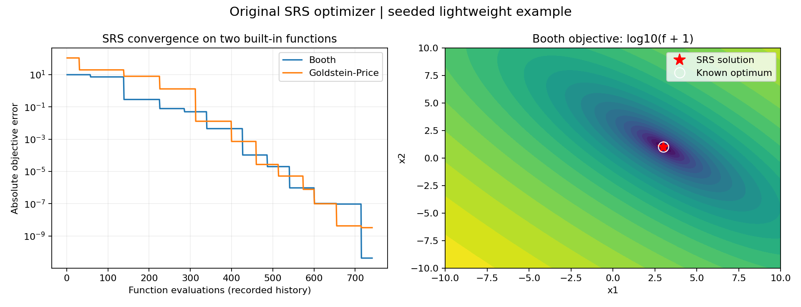

<!-- readme-visual-refresh:banner -->

<!-- /readme-visual-refresh:banner -->

# SRS_python
The Strategic Random Search (SRS) —— A New Global Optimization Algorithm  

There are two files here：
- ***SRS_python.py*** is the main code of the SRS algorithm, which has 10 built-in test functions;
- ***SRS_help.ipynb*** is an example of the use of the srs algorithm, which gives the detailed usage of the SRS code.
- ***xinanjiang_model.py*** is the code of xinanjiang model, it includes the main process of xinanjiang model and calibration of xinanjiang model. Here, we can choose vectorised model to improve time efficiency.
- Other codes are the baseline codes for the Xinanjiang model.

## ref
please consider cite the following article:  
Haoshan Wei, Yongqiang Zhang, Changming Liu, Qi Huang, Pengxin Jia, Zhenwu Xu, Yuhan Guo, The strategic random search (SRS) – A new global optimizer for calibrating hydrological models, Environmental Modelling & Software, 2023, https://doi.org/10.1016/j.envsoft.2023.105914.

<!-- readme-visual-refresh:artwork-source -->
[Editable banner artwork · Excalidraw](assets/readme/banner.excalidraw)
<!-- /readme-visual-refresh:artwork-source -->

<!-- readme-visual-refresh:execution -->
## Demonstration captured on EHPC · 17 October 2026

Original optimization routine executed on its explicit synthetic Booth-function example. The marked analytic minimum follows the original function's variable order at (3, 1); this is an algorithm demonstration.

[Execution record and checksums](assets/readme/execution-record.json).
<!-- /readme-visual-refresh:execution -->
